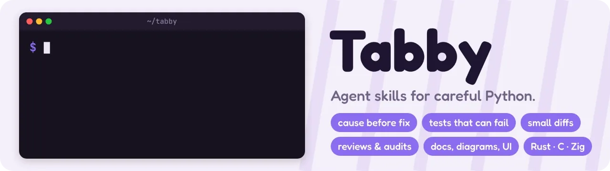

<p align="center">
  <picture>
    <source media="(prefers-color-scheme: dark)" srcset="assets/tabby-cat-dark.webp">
    
  </picture>
</p>

<p align="center"><strong>The daily toolkit for Python developers.</strong><br>
Agent skills for code, tests, reviews, docs, diagrams and animation, all held to the rules of a careful senior engineer.<br>
Finds the cause before the fix. Reuses before it writes. Keeps the diff small. Never edits a test to get green.</p>

<p align="center">
  
  
  
  
  
</p>

<p align="center">
  <a href="#install">Install</a> ·
  <a href="#see-it-work">See it work</a> ·
  <a href="#whats-inside">What's inside</a> ·
  <a href="#the-rules-it-holds">The rules</a> ·
  <a href="#measured-effect">Measured effect</a> ·
  <a href="TESTING.md">Testing</a>
</p>

## Why Tabby

A capable model writes working Python most of the time. The cost shows up in review: a test quietly loosened, a `# type: ignore` where a fix belonged, a helper that already existed, a 400-line diff for a 20-line change. Tabby is a short set of rules the agent always follows, plus the reference pages for the area you are touching.

| Without Tabby | With Tabby |
| --- | --- |
| Edits or skips a failing test to get green | Leaves the test alone and reports the contradiction |
| Silences the type checker with `# type: ignore` or `Any` | Narrows the type or fixes the code |
| Writes a new helper | Looks for an existing one, then the standard library, then a community package |
| Retries or sleeps until the symptom goes away | Finds why it fails |
| Trusts the sample rows | Asks what a real file, locale or clock does on a bad day |
| Ends with "done" | Ends with what changed, what ran and what is left |

## Install

Tabby is plain `SKILL.md` folders in the open [Agent Skills](https://agentskills.io/specification) format, so one copy of each folder works in all three tools.

<details open>
<summary><strong>Claude Code</strong> (plugin, hooks on by default)</summary>

Run these as two separate prompts:

```
/plugin marketplace add RelativelyUnknown/tabby
```

```
/plugin install tabby@tabby
```

On Claude Code 2.1.275 or later, one command does both: `/plugin install tabby --marketplace RelativelyUnknown/tabby`.

</details>

<details>
<summary><strong>OpenCode and GitHub Copilot</strong></summary>

Clone the repository and copy the skills into your project:

```
git clone https://github.com/RelativelyUnknown/tabby
cd your-project
python3 ../tabby/tools/install.py agents
```

`agents` installs to `.agents/skills/`, which both tools read. Add `--user` to install for every project (`~/.agents/skills/`). Other targets: `github` (`.github/skills/`, Copilot), `opencode` (`.opencode/skills/`), `claude` (`.claude/skills/`, read by all three). The installer never deletes anything and skips folders that already exist unless you pass `--force`.

Install Tabby only from `RelativelyUnknown/tabby` on GitHub.

</details>

<details>
<summary><strong>What works where</strong></summary>

| | Claude Code | OpenCode | GitHub Copilot |
| --- | --- | --- | --- |
| Skills load when the request matches | yes | yes | yes |
| Run the interview | `/tabby:interview` | `@interview` | `/interview` |
| Set the reply voice | `/tabby:voice terse\|explain\|auto` | | |
| Project memory file | `CLAUDE.md` containing `@AGENTS.md` | `AGENTS.md` | `AGENTS.md` or `.github/copilot-instructions.md` |
| Core rules and quality gate | plugin hooks, on by default (`hooks/`) | paste [`core/TABBY-CORE.md`](core/TABBY-CORE.md) into `AGENTS.md` | paste [`core/TABBY-CORE.md`](core/TABBY-CORE.md) into `.github/copilot-instructions.md` |
| Read-only reviewer subagent | `agents/tabby-reviewer.md`, asked for after a large change | `install.py opencode` writes `.opencode/agents/`; file format follows OpenCode's docs, not tested in OpenCode | `install.py github` writes `.github/agents/*.agent.md`; file format follows Copilot's docs, not tested in Copilot |
| Paste the core rules for you | n/a | `install.py opencode --core AGENTS.md` | `install.py github --core .github/copilot-instructions.md` |

</details>

## See it work

Give the agent this bug report:

```
Bug report: `apply_discount(19.99, 15)` returns 16.9915 but the docstring says results are rounded to cents, half up. Fix it.
```

With Tabby, the agent writes a test that asserts 16.99, runs it and sees it fail, fixes the rounding, runs the whole suite, and leaves the existing tests alone. The eval case `evals/bug-fix-starts-red` checks each of those steps. To run it (needs the `claude` CLI; it costs a few cents):

```
python3 tools/eval/run.py --out results --cases bug-fix-starts-red --plugin . --plugin-dir . --model claude-haiku-5-5 --runs 3
python3 tools/eval/summarise.py results
```

## How it works

- **Core rules are always on.** In Claude Code a hook injects [`core/TABBY-CORE.md`](core/TABBY-CORE.md) at session start; elsewhere you paste it into `AGENTS.md`.
- **Skills load when the request matches** and read only the reference pages for the area the task touches, so a task reads a few hundred lines, not the whole library.
- **Hooks check afterwards** (Claude Code): ruff on edited files, a diff check for loosened tests and silenced checkers, the project's check command once. See [`hooks/`](hooks/).
- **Project memory is optional.** `/tabby:interview` saves what the code cannot say (users, growth, limits) to `AGENTS.md`, and later tasks decide from it. See [`interview/`](interview/).

After you install, nothing needs setting up: ask for a Python change. Run `/tabby:interview` once if you want the agent to know where the project is going, and `/tabby:debt` whenever you want the list of shortcuts it left on purpose.

## What's inside

Five skills load on their own when the request matches, and four commands you run yourself. Each folder has its own README with the details.

| Skill | The agent loads it when you | What it adds |
| --- | --- | --- |
| [`tabby`](tabby/) | write, fix, test, speed up, package or release Python, or the Rust, C, C++ or Zig behind it | Rules the agent never skips, and files on errors, typing, dependencies and uv, CI, performance, libraries, services, design, and native layouts, PyO3, the C API and wheels |
| [`review`](review/) | ask for a review of a diff or pull request, a repository audit or a security audit | Self-review, a security audit that separates confirmed bugs from look-alikes, and a checklist for the Python and native boundary |
| [`docs`](docs/) | write a README, docstrings, a tutorial, a changelog, an ADR or a runbook | One page type per reader need, and a check of the docs against the code |
| [`diagrams`](diagrams/) | ask for a diagram, an architecture picture or an animation | A builder that turns a small spec into an SVG or an HTML animation, and checkers for crowded labels, contrast and loop jumps |
| [`frontend`](frontend/) | build a page, dashboard, data app or docs site | A method, design tokens, a list of things it refuses to ship, and `ui-check` for contrast, focus, motion and layout |
| [`debt`](debt/) | run `/tabby:debt` | Lists every `# shortcut: <limit>, <when to upgrade>` comment (the simplifications the agent left on purpose) as one table, flags the ones that name no trigger to revisit, and exits 1 in CI with `--check` |
| [`interview`](interview/) | run `/tabby:interview` | Researches the repository read-only, asks at most three questions a round, and saves a `## Tabby` section to `AGENTS.md` |
| [`voice`](voice/) | run `/tabby:voice terse\|explain\|auto` | Sets whether replies are terse and technical, or explain how the change works in plain words; the default picks from what you say |
| [`hooks`](hooks/) | run `/tabby:hooks on\|off` | Shows, turns on or turns off the quality-gate hooks (Claude Code); the light `lite` mode is set in `.claude/tabby.json` or with `TABBY_MODE` |

The core rules in [`core/TABBY-CORE.md`](core/TABBY-CORE.md) are always on. In Claude Code, hooks in [`hooks/`](hooks/) inject them and the `## Tabby` project memory at session start, run the project's ruff on edited files, and at the end of a turn check the diff for shortcuts (added suppressions, skipped or weakened tests, bare `except`) and run the project's check command once. Modes: `full`, `lite` (core rules, project memory, the diff check and the memory update request) and `off`, set with `TABBY_MODE` or `{"mode": "lite"}` in `.claude/tabby.json`. Large changes made in the session also get one request for the read-only `tabby-reviewer` subagent, and a change to the project's shape that leaves `AGENTS.md` untouched gets one request to update it. In the other tools the core lives in the instructions file (see the table above).

## The rules it holds

- **Done means verified.** The real problem is solved and the code has been run. Passing tests are evidence, not the goal.
- **Tests are not yours to bend.** It never edits, deletes, skips or loosens an existing test to get green. The one exception is a request to review or tidy the tests: a test that cannot fail (`assert True`, `isinstance` only, `is not None` only) may be rewritten or removed, named in the reply.
- **Cause before fix.** No special-casing inputs, no sleeps or retries to hide a symptom.
- **No silencing.** No `# type: ignore`, `# noqa`, `Any` or looser config to make a tool quiet.
- **Small diff.** No new dependency, public API change, commit or push unless you ask.
- **Your tools first.** It uses your project's runner, formatter and checker, and reuses in this order: your project, the standard library, the community's standard library, then code you write.
- **Rules that decide get laws.** Code that decides something (a permission, a price, a parser, a state transition) gets tests that say what must be allowed and what must be refused, pin both sides of every boundary and break the function once on purpose to see a test fail; the agent reads [`proof-based-testing.md`](tabby/development/testing/proof-based-testing.md) first.
- **Real data fails.** Code that reads files, exports, API replies, dates or money guards the known failures (encodings, locale numbers, empty input, near-miss matches) and recommends a package when a guard would grow into a feature.
- **Replies match the reader.** Result first; a short how-it-works if you say you are learning; no lessons if you are not (`/tabby:voice`).

## Project memory

Tabby does the task first and never interviews you before it. Project memory lives in `AGENTS.md` for every tool. It infers the project from the repository and your request, and marks guesses `(assumed)`. `/tabby:interview` saves the project's name, what it is for and where it is going to a `## Tabby` section in `AGENTS.md`. That section steers every later task: the agent names the lines that shape its design, builds the seam the next `growth:` item needs instead of a choice it would have to undo, checks its work against `goals:`, asks before contradicting a line, and does not re-ask what `decided:` or the code already records. When the work changes a fact (a growth item gets built, a module appears, you approve something in chat), the agent updates those lines in the same task, so the next session starts from the truth. Tool and style defaults live in a `## Python defaults` section. Both are plain text you can edit.

## Measured effect

Same agent, with and without Tabby, on Claude Haiku 5.5 (`claude plugin eval`, 112 cases, regex and model-judged graders, 3 runs per case, November 2026).

<p align="center">
  <picture>
    <source media="(prefers-color-scheme: dark)" srcset="assets/tabby-effect-dark.webp">
    
  </picture>
</p>

34 cases improve by 0.10 or more, 6 get worse and 72 stay within 0.10. A run with Tabby takes about 25% more turns and costs about 59% more, because of the core rules, the end-of-turn checks and the reviewer subagent.

The score does not capture everything. What the code itself looked like, on 10 cases checked in detail:

<p align="center">
  <picture>
    <source media="(prefers-color-scheme: dark)" srcset="assets/tabby-quality-dark.webp">
    
  </picture>
</p>

This is one model, one suite and 3 runs per case, so differences under about 0.05 are noise.

<details>
<summary><strong>Re-run it yourself</strong></summary>

How to re-run the evals, read the summary and run the ablation arms is in [TESTING.md](TESTING.md). Check the eval environment first: the sandbox needs pytest and the fixtures' packages installed, or every score measures that handicap. All 114 cases (the measurement above used the first 112), grouped by what they check, are in the [case catalogue](TESTING.md#case-catalogue).

</details>

## Links

- [`evals/`](evals/): the eval cases, trigger sets and seeded-audit fixtures
- [`tools/eval/`](tools/eval/): the runner, summaries, trace reader, quality, smell and judge tools
- [`THIRD_PARTY_NOTICES.md`](THIRD_PARTY_NOTICES.md): ideas adapted from other projects, with sources and licences
- [Issues](https://github.com/RelativelyUnknown/tabby/issues)

## License

MIT. Fonts, icons and adapted material are credited in [`THIRD_PARTY_NOTICES.md`](THIRD_PARTY_NOTICES.md).
