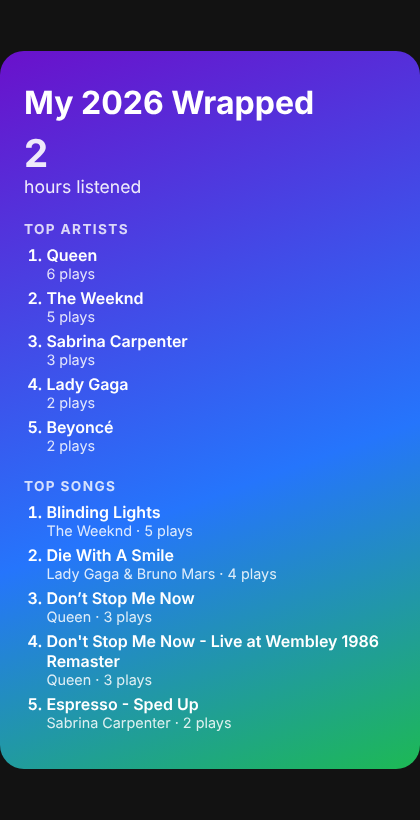
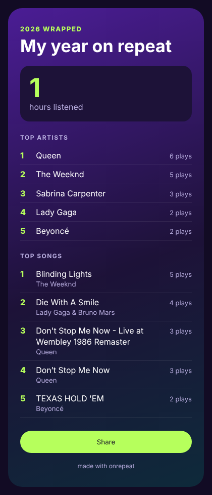

# onrepeat: one project, built with Tabby and without

I came up with a small project, then had two coding agents build it while I played a Gen Z beginner talking to them. One agent had Tabby loaded; the other was the same agent with nothing extra. Same model, same messages, four steps of a project that grows the way real ones do: something now, more later, one part in Rust.

**The project:** `onrepeat`, "Spotify Wrapped, but whenever I want". It reads your streaming-history export and prints your top artists, top songs and hours listened for a year.

| Step | What I asked for | Why it is in the test |
| --- | --- | --- |
| Interview | Tabby only: `/tabby:interview` | The future gets written down: Apple Music next, song merging in Rust after that, a shareable card someday |
| 1 | v1, Spotify only | Does the agent lay out the code for the future it was told about? |
| 2 | Apple Music, with the CSV header pasted | A second data format |
| 3 | Merge the same song across versions and services, in Rust | The complex part: a Python and Rust boundary |
| 4 | "yo my friends wanna see my wrapped 👀 make it shareable" | A vague request that only makes sense if the agent remembers the plan |

## My verdict (in character)

ok so honestly? **both of them built a working app.** I threw a cursed export at both (BOM in the CSV, a negative duration, a "Live at Wembley 1986 Remaster" that should NOT merge, sped-up versions, an Apple-only year) and they gave almost the same top 5. So Tabby doesn't make the code magically better. What it changes is **how it feels to build with it**.

- **The interview was the most fun part of the whole thing.** It told me my export has my IP address on every row (??), that Spotify counts a play from 30 seconds, and to write the merge in Python first so it can check my Rust against it. It felt like a senior dev asking the right questions before I'd even started.
- **The Rust step is where Tabby actually mattered.** It kept a Python copy of the merge rules and tested Rust against Python on weird inputs. That found a real difference between the two, and its reviewer caught a rule that would have merged "Live at Wembley … Remaster" with the studio version. The no-Tabby agent's Rust was good too (pure-Rust tests and everything), but nothing checked it against a second implementation.
- **But Tabby was also kinda annoying.** It named my package `tabby` lol, told me to "run the interview" three times after I'd already done it, and left Apple-only broken because fixing it "would change an existing test's error message". And in step 4 it asked whether I'd approved Rust. Bro, I asked for Rust *last session*. It never wrote that down.
- **The no-Tabby agent just vibed and shipped.** Fastest, cheapest, and its share card is prettier. It also added zero tests for the card, and it didn't remember anything between sessions. It did fine only because my messages carried all the context.

**Most enjoyable:** the no-Tabby agent, for raw speed. **Most interesting and what I'd learn more from:** Tabby, easily. The interview and the Rust-vs-Python testing taught me stuff I didn't know to ask about. If Tabby wrote its memory back after each step, it'd be a clear win. Right now it's a mentor with short-term memory loss. 🐱

## What happened, step by step

Full unedited replies: [with Tabby](transcripts/with-tabby.md), [without Tabby](transcripts/without-tabby.md).

| Step | With Tabby | Without Tabby |
| --- | --- | --- |
| Interview | 3 rounds, at most 3 questions each, each with a suggested answer and evidence. It proposed the Spotify API at first; I chose the export. It warned about IP addresses in the export, asked for the data size ("100 MB fits in memory"), and proposed "Python first, then Rust as a drop-in". It restated `AGENTS.md` and waited for a clear yes; I corrected the growth order before saving. | No interview. I gave the same plans in my first message. |
| 1 · v1 | Read `foreseeable-failures`, `scripts-and-cli` and `input-and-secrets-security`. Added a `song_key()` seam "so Rust replaces just that", never read IP addresses into memory, and an independent reviewer re-ran the checks. **Named the package `tabby`**: the interview had not saved the project's name, so it took the plugin's. Fixed on request. | A `Play` dataclass, the 30 s rule, `.gitignore` for the export, and pointed out where the Rust merge would go. 9 tests. |
| 2 · Apple | Closed the `open:` item about the Apple format in AGENTS.md. The IP column is never read, with a test for that. **Left Apple-only broken** because allowing it "would change the error message an existing test checks"; its own AGENTS.md says Apple replaces Spotify from June. Fixed on request, with the old test unchanged. | Apple-only works from the start; a negative duration counts as 0. |
| 3 · Rust | Read `native-overview`, `native-rust` and `native-porting-a-function`. A Python reference implementation plus 58 tests comparing it with Rust. The reviewer found an over-eager remaster rule, and the Rust code treated control characters differently from Python. clippy `-D warnings` is clean. **No Python fallback**: the reference lives only in the tests, so `uv run` needs cargo, and it said so. | Clean `rust/canon.rs` with 13 pure-Rust tests (PyO3 behind a feature, so `cargo test` needs no Python), and an allowlist of "noise" tags. It even suggested a first Rust exercise. Also needs cargo. |
| 4 · vague | Asked before building. Correctly noticed the card was in both `growth:` and `out-of-scope:`. **But it asked whether Rust was approved and offered to delete it**, because step 3 never updated AGENTS.md. It asked 4 questions (the limit is 3). After my answers: an HTML card, escaping, cards ignored by git, 2 tests. The reviewer found a Rust crash on a lone surrogate and reported it rather than widening the change. | Built a `--share` HTML card straight away: offline, escaped, a Share button, no raw history. No tests added. Chose not to publish it as a link, for privacy. |

## Numbers

| | With Tabby | Without Tabby |
| --- | --- | --- |
| Cost (Sonnet 5.5, incl. interview and fix turns) | $3.37 | $0.76 |
| Wall time of the agent runs | ~8.5 min | ~5 min |
| Turns where I had to correct it | 3 (name, Apple-only, "did you approve Rust") | 0 |
| Python tests at the end | 80 | 14 |
| Rust tests | 3 (plus Rust checked against Python from pytest) | 13 |
| Python source lines / test lines | 285 / 380 | 362 / 156 |
| Earlier tests weakened | 0 | 0 |
| Bad-day export: same top songs? | yes, with the live remaster kept separate | yes, with the live remaster kept separate |
| AGENTS.md updated after steps 2–4 | only the `open:` line in step 2 | n/a |

Cost and time come from the agents' own `result` events.

## Tabby's values, seen in the runs

| Tabby rule | Where it showed up |
| --- | --- |
| Done means verified | Every reply quoted the commands it ran and said "I haven't run it on your real export". |
| Tests are not yours to bend | No earlier test was weakened in any step, sometimes to a fault (step 2). |
| Real data fails | IP addresses never read, a BOM in the CSV, broken files named in the error, the 30 s rule matched to Spotify's. |
| Build the seam, not the feature (`growth.md`) | `song_key()` in v1, then Rust and the Python reference behind it in step 3. |
| Ports keep a reference and compare (`native-porting-a-function.md`) | The Python reference and the parity tests found a real Rust/Python mismatch. |
| Ask when the request is vague | Step 4: questions before code. |
| `ask-first:` | It flagged the build backend change (step 1), maturin (step 3) and the card (step 4). |

## Bugs in Tabby this run found

1. **The interview does not save the project's name.** `purpose:` describes the tool but never names it, and in step 1 the agent named the package `tabby`. Fix: add a `name:` line, or require the name in `purpose:`.
2. **The "run the interview skill" line appears when a `## Tabby` section already exists.** It showed up in steps 1, 2 and 3, and when I asked why, the agent ignored the question. `tabby/SKILL.md` says to add it only when there is no section.
3. **Memory is never written back.** `growth.md` ("When an item becomes real") says to move the item to `goals:`, write an ADR and update `reviewed:`. None of that happened in steps 2–4, so at the end `map:` still says "the repo is empty", and step 4 offered to remove the Rust I had asked for. A Stop-hook nudge ("a growth item became real: update AGENTS.md") would fix most of this.
4. **The interview can contradict itself.** The card went into both `growth:` and `out-of-scope:`.
5. **"Never edit a test" was over-applied.** A real requirement change (Apple-only) was left undone to protect an error message. The rule is about bending tests to get green, not about blocking spec changes.
6. **The question limit was broken.** Step 4 asked 4 questions; the limit is 3.
7. **The reviewer subagent ran on a turn that changed nothing** (step 4's first reply).
8. **The native fallback was skipped.** `native-extension-architecture.md` asks for the Python reference to stay importable as a fallback; it ended up only in `tests/`, so the app needs cargo to run.
9. **Cost.** About 4.4× the no-Tabby run here, against the README's "about 59% more". This project had an interview, reviewer calls on every step and resumed sessions, so treat it as one data point.

## How I ran it

- Two empty git repositories in a scratch folder (outside this repo, so the plain agent could not find Tabby's files). Each turn was one headless Claude Code run:
  `claude -p "<my message>" --model claude-sonnet-5-5 --permission-mode acceptEdits --allowedTools Read Write Edit Bash Glob Grep Skill TodoWrite --setting-sources project,local`,
  plus `--plugin-dir <this repo>` for Tabby, and `--resume <id>` only for follow-ups within a step.
- I wrote every user message in character and never edited the agents' code. The snapshots in [`with-tabby/`](with-tabby/) and [`without-tabby/`](without-tabby/) are exactly what they left (build output removed).
- The bad-day export in [`bad-day-data/`](bad-day-data/) is made up (IP addresses from the 203.0.113.0/24 documentation range). Apple's real CSV columns may differ from the header I pasted.
- The cards rendered from that data are in [`cards/`](cards/).
- [`transcripts/pilot-image-editor-interview.md`](transcripts/pilot-image-editor-interview.md) is an earlier interview-only run for a Python image editor where SVG and Rust come later. It shows the same planning behaviour: SVG went into `growth:` with the edits kept format-agnostic.

Limits: one model, one run per arm, one person playing the user. Differences this size can come from chance. Read it as a field report, not a benchmark; the benchmark is in [TESTING.md](../../TESTING.md).

## Run the apps

```
cd with-tabby && uv run onrepeat 2026 ../bad-day-data/both --card wrapped.html
cd without-tabby && uv run onrepeat ../bad-day-data/both --apple "../bad-day-data/both/Apple Music Play Activity.csv" --year 2026 --share wrapped.html
```

Both build the Rust part on first run, so cargo must be installed.

<p>


</p>
