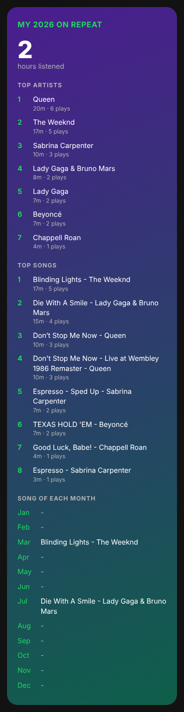

# onrepeat: one project, built with Tabby and without

I came up with a small project and had coding agents build it while I played a Gen Z beginner talking to them. I never edited their code. Three agents, same model (Sonnet 5.5), same messages, and five steps of a project that grows the way real ones do:

| Agent | Plugin | Did it know the future plans? |
| --- | --- | --- |
| **With Tabby** | Tabby | Yes, from `/tabby:interview`, saved in `AGENTS.md` |
| **Told** | none | Yes, I typed them in my first message |
| **Never told** | none | No; every later feature arrives as a surprise |

**The project:** `onrepeat`, "Spotify Wrapped, but whenever I want". It reads your streaming-history export and prints your top artists, top songs and hours listened for a year.

| Step | What I asked for | Planned? |
| --- | --- | --- |
| 1 | v1, Spotify only | |
| 2 | Apple Music (the CSV header pasted) | yes, in the plans |
| 3 | Merge the same song across versions and services, in Rust | yes, in the plans |
| 4 | "yo my friends wanna see my wrapped 👀 make it shareable" | yes, but phrased vaguely |
| 5 | "my #1 song for every month, in the terminal AND on the card" | no, a new idea |

Every step after the first ran in a fresh session, like coming back another day.

## Did the interview make new features cheaper?

I rebuilt the code after every step by replaying each agent's file edits from its log ([`tools/replay.py`](tools/replay.py); the replay reproduces each final tree exactly). Then I counted how much **code that already existed** each feature had to change ([`tools/churn.py`](tools/churn.py)). New files are additions; lines deleted from existing files are rework.

Existing source lines changed per feature (+added / −deleted; tests, docs and lock files left out):

| Step | With Tabby | Told | Never told |
| --- | --- | --- | --- |
| 2 · Apple Music | +19 / −4 | +23 / −3 | **+118 / −31** |
| 3 · Rust merge | +28 / −8 | +19 / −4 | +19 / −9 |
| 4 · Share card | +15 / −0 | +16 / −1 | +10 / −0 |
| 5 · Monthly #1 (unplanned) | +39 / −3 | +39 / −2 | **+65 / −20** |

The Tabby numbers include the follow-up turns I needed; the package rename in step 1 is left out.

**What this says:**

1. **Knowing the future made features cheaper. *How* the agent learned it made no difference.** With Tabby and Told added each feature as a new file plus a few lines of wiring, and the numbers are nearly identical. Never told had to undo a v1 design decision when Apple Music arrived.
2. **The rework had a concrete cause.** Never told's v1 grouped songs by **Spotify's track ID**, a good choice for a Spotify-only app. Apple Music has no track IDs, and a remaster has a different ID, so step 2 removed the `track_uri` field, rewrote most of the loader and changed the grouping key (−31 of its 327 existing source lines). Knowing that "Apple and song merging are coming" is exactly what rules that design out.
3. **Nobody had to rewrite the whole app.** Even the worst case was one reworked module. A small CLI is forgiving, and all three agents split it into loader, stats and output on day one. The gap would grow with the size of the project.
4. **The Tabby seam worked as designed.** In v1 the Tabby agent wrote `song_key()` as "the one place that decides which plays are the same song", citing the plan in `AGENTS.md`. In step 3 the Rust change swapped the body of that function and nothing else moved.
5. **Code is memory too.** Told only heard the plans once, in session 1. Sessions 2–5 never saw them, yet worked just as well, because the plans were already built into the layout. Tabby's `AGENTS.md` carried the plans *and* the reasons (privacy, the 30-second rule, ask-first), but it went stale, because no session after the interview updated it (see the bugs below).

So the interview's value is not better code than a well-briefed agent. It's that you don't have to know what to brief. The interview asked about the data size, the privacy of the export, the order of the features and Python-before-Rust. As a beginner I would not have typed all of that unprompted.

## My verdict (in character)

ok so honestly? **all three built a working app**, and on my cursed test export (BOM in the CSV, a negative duration, a "Live at Wembley 1986 Remaster" that should NOT merge, sped-up versions, an Apple-only year) they gave the same top 5. Tabby doesn't magically write better code.

- **The interview was the most fun part.** It told me my export has my IP address on every row (??), that Spotify counts a play from 30 seconds, and to do the merge in Python first so it can check my Rust against it. It felt like a senior dev asking the right questions before I'd even started.
- **The Rust step is where Tabby actually mattered.** It kept a Python copy of the merge rules and ran 58 tests comparing Rust with Python. That found a real mismatch, and its reviewer caught a rule that would have merged the live version with the studio one. The other two wrote good Rust as well, but nothing checked it against a second version.
- **The agent that never knew the plans did fine, but it had to redo stuff.** Step 2 made it rip out its Spotify-ID design. Not a disaster, but that's the "rewrite for one feature" thing, on a small scale.
- **Tabby was also kinda annoying.** It named my package `tabby` lol, told me to "run the interview" again and again after I'd done it, left Apple-only broken to protect an old test's error message, and in step 4 asked whether I'd approved Rust. Bro, I asked for Rust *last session*. Its memory file never got updated.
- **The no-Tabby agents just vibed and shipped.** Faster, about a quarter of the cost, and their share cards are prettier.

**Most enjoyable:** without Tabby, for raw speed. **Most interesting, and the one I learned the most from:** Tabby, easily. If it wrote its memory back after each step, it'd be a clear win. Right now it's a mentor with short-term memory loss. 🐱

## What happened, step by step

Full unedited replies: [with Tabby](transcripts/with-tabby.md), [told](transcripts/without-tabby.md), [never told](transcripts/never-told.md).

| Step | With Tabby | Told | Never told |
| --- | --- | --- | --- |
| Interview | 3 rounds, at most 3 questions each, each with a suggested answer and evidence. It proposed the Spotify API; I chose the export. It warned about IP addresses, asked for the data size, and proposed "Python first, then Rust as a drop-in". It restated `AGENTS.md` and waited for a yes; I corrected the growth order. | n/a | n/a |
| 1 · v1 | A `song_key()` seam "so Rust replaces just that"; IP addresses never read; a reviewer subagent re-ran the checks. **Named the package `tabby`**: the interview had not saved the name. | A `Play` dataclass, the 30 s rule, `.gitignore` for the export, and it pointed out where the Rust merge would go. | Songs grouped by Spotify track ID; ranked by time; `--min-seconds`. Committed to git unasked. |
| 2 · Apple | The IP column is never read, with a test for that. **Left Apple-only broken** to protect an existing test's message; fixed on request. | Apple-only works; a negative duration counts as 0. | Replaced the track-ID key, and aligned Apple start times with Spotify end times (the only agent to notice). |
| 3 · Rust | A Python reference plus 58 parity tests; the reviewer caught an over-eager remaster rule and a Rust/Python mismatch. **No Python fallback**: the reference lives only in `tests/`. | `rust/canon.rs`, 13 pure-Rust tests, PyO3 behind a feature so `cargo test` needs no Python. | A Rust `song_key`; its tests caught a Unicode bug (が merged with か) and it fixed it. |
| 4 · Share | Asked first, 4 questions (the limit is 3). **Asked whether Rust was approved**, because `AGENTS.md` was never updated. Then an HTML card with 2 tests. | An HTML card with a Share button, straight away; no tests added. | An HTML card straight away; 1 test. |
| 5 · Monthly | Small change in 2 files, 1 test. Noticed `AGENTS.md` was stale, but suggested re-running the interview instead of updating it. | Small change in 3 files, 2 tests. | 3 files, more rework (−20 lines). |

## Numbers

| | With Tabby | Told | Never told |
| --- | --- | --- | --- |
| Cost, all steps (incl. interview and fix turns) | $3.65 | $0.90 | $1.06 |
| Wall time of the agent runs | ~9.5 min | ~5.5 min | ~6.5 min |
| Turns where I had to correct it | 3 | 0 | 0 |
| Python tests / Rust tests at the end | 81 / 3 | 16 / 13 | 33 / 11 |
| Earlier tests weakened | 0 | 0 | 0 |
| Bad-day export: correct top songs, live remaster kept separate | yes | yes | yes |
| Run time on 160k plays (8 files) | ~0.75 s | ~0.75 s | not measured |

The cost and time figures come from the agents' own `result` events.

## Tabby's values, seen in the runs

| Tabby rule | Where it showed up |
| --- | --- |
| Done means verified | Every reply quoted the commands it ran and said "I haven't run it on your real export". |
| Tests are not yours to bend | No earlier test was weakened, sometimes to a fault (step 2). |
| Real data fails | IP addresses never read, a BOM in the CSV, broken files named in the error, the 30 s rule matched to Spotify's. |
| Build the seam, not the feature (`growth.md`) | `song_key()` in v1; the Rust change swapped its body in step 3. |
| Ports keep a reference and compare (`native-porting-a-function.md`) | The Python reference and parity tests found a real Rust/Python mismatch. |
| Ask when the request is vague | Step 4: questions before code. |
| `ask-first:` | Flagged the build backend change (step 1), maturin (step 3) and the card (step 4). |

## Bugs in Tabby this run found

This branch fixes 1–8 (see `CHANGELOG.md`, Unreleased); 9 drops as a side effect, because the reviewer is no longer asked on a turn that changed nothing. The runs above used the version before those fixes.

1. **The interview does not save the project's name.** `purpose:` describes the tool but never names it, and in step 1 the agent named the package `tabby`. Fix: add a `name:` line.
2. **The "run the interview skill" line appears when a `## Tabby` section already exists.** It showed up in steps 1, 2, 3 and 5, and when I asked why, the agent ignored the question.
3. **Memory is never written back.** `growth.md` ("When an item becomes real") says to move the item to `goals:`, write an ADR and update `reviewed:`. That never happened, so `map:` still says "the repo is empty", and step 4 offered to remove the Rust I had asked for. A Stop-hook nudge ("a growth item became real: update AGENTS.md") would cover most of it.
4. **The interview can contradict itself.** The card went into both `growth:` and `out-of-scope:`.
5. **"Never edit a test" was over-applied.** A real requirement change (Apple-only) was left undone to protect an error message.
6. **The question limit was broken.** Step 4 asked 4 questions; the limit is 3.
7. **The reviewer subagent ran on a turn that changed nothing** (step 4's first reply).
8. **The native fallback was skipped.** The Python reference ended up only in `tests/`, so the app needs cargo to run. Also, `song_key()` crosses into Rust once per play, where `native-extension-architecture.md` asks for batches. At 160k plays this cost nothing measurable.
9. **Cost.** About 4× the other two, against the README's "about 59% more". The interview, a reviewer call on every step and resumed sessions add up; treat it as one data point.

## How I ran it

- Empty git repositories in a scratch folder outside this repo, so the agents without Tabby could not find Tabby's files. Each turn was one headless Claude Code run:
  `claude -p "<my message>" --model claude-sonnet-5-5 --permission-mode acceptEdits --allowedTools Read Write Edit Bash Glob Grep Skill TodoWrite --setting-sources project,local`,
  plus `--plugin-dir <this repo>` for Tabby, and `--resume <id>` only for follow-ups within a step.
- Snapshots: [`with-tabby/`](with-tabby/), [`without-tabby/`](without-tabby/) (told) and [`never-told/`](never-told/) hold exactly what the agents left, minus build output.
- [`bad-day-data/`](bad-day-data/) is a made-up export (IP addresses from the 203.0.113.0/24 documentation range). Apple's real CSV columns may differ from the header I pasted. The cards rendered from it are in [`cards/`](cards/).
- [`transcripts/pilot-image-editor-interview.md`](transcripts/pilot-image-editor-interview.md) is an earlier interview-only run for a Python image editor with SVG and Rust planned for later. SVG went into `growth:` with the edits kept format-agnostic.

Limits: one model, one run per agent, one person playing the user. Differences this size can come from chance. Read it as a field report, not a benchmark; the benchmark is in [TESTING.md](../../TESTING.md).

## Run the apps

```
cd with-tabby && uv run onrepeat 2026 ../bad-day-data/both --card wrapped.html
cd without-tabby && uv run onrepeat ../bad-day-data/both --apple "../bad-day-data/both/Apple Music Play Activity.csv" --year 2026 --share wrapped.html
cd never-told && uv run onrepeat ../bad-day-data/both --year 2026 --html wrapped.html
```

All three build the Rust part on first run, so cargo must be installed.

<p>



</p>
